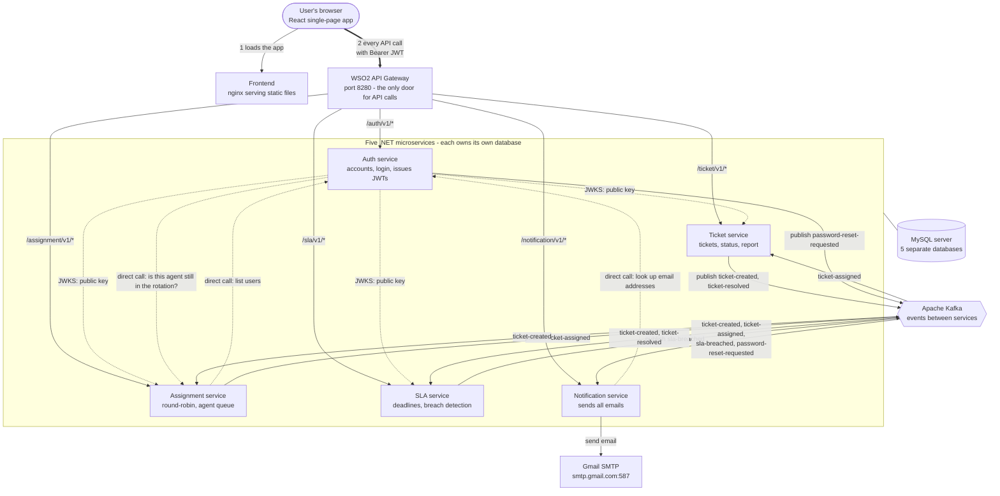
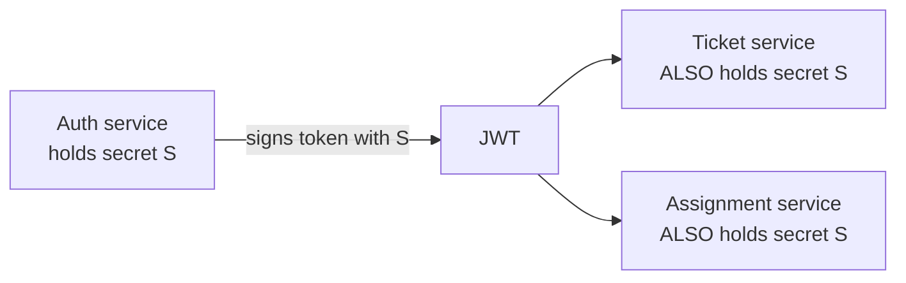
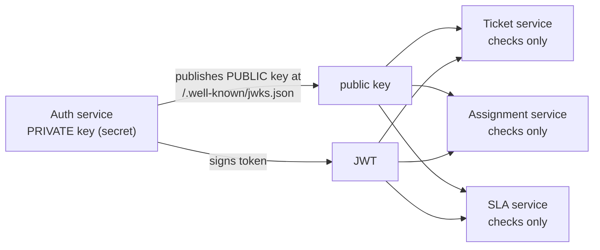
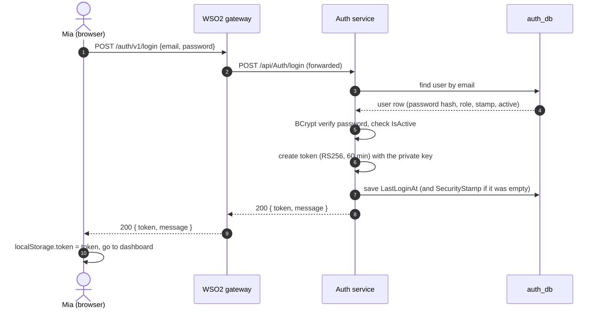
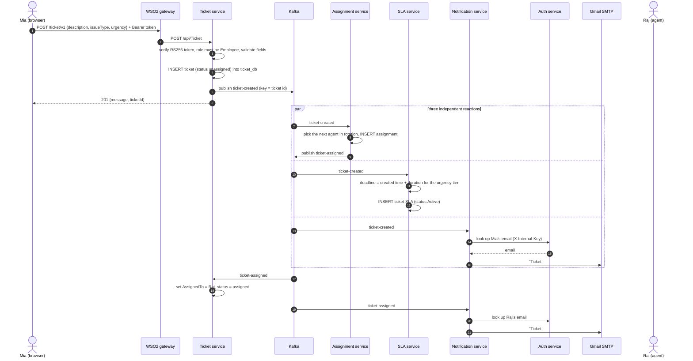
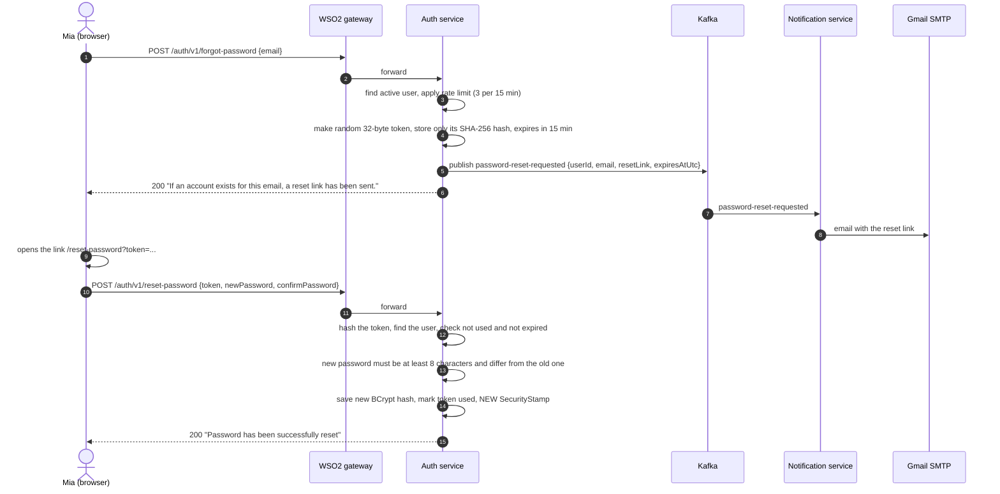

# IT Helpdesk Platform — Architecture and End-to-End Flow

**Code described:** `develop` at commit `9e2fcd9` (Sprint 4), read on 2026-10-13.
**Where it runs:** Azure Container Apps (see section 8). It can also run locally (section 8.3).

This document explains the system in two parts:

1. **The architecture diagram, explained** — what every box and arrow means, and why
   the system is built this way (sections 1–2).
2. **A complete walk-through** of what happens from the moment a user opens the site
   until they log out, with the technical detail behind every step (sections 3–7).

It replaces the Sprint 3 architecture description. Back then every service validated JWTs with the
same shared signing key and there was no central gateway; both are different now (see section 3.1).
The `README.md` has been updated to match.

> **How much of this was tested?** Read it as two levels of confidence.
> *Tested live on Azure on 2026-10-13:* login through the gateway, the RS256 token and its
> claims, the public key (JWKS) endpoint, token validation by the ticket service
> (valid token → 200, no token → 401, tampered token → 401), the admin routes
> `/auth/v1/me`, `/auth/v1/users`, `/ticket/v1/report`, the forgot-password route, and the
> database migration. *Read from the code but not run end to end:* the Kafka flows, the
> emails, the SLA timers and breach alerts, and the browser UI. Where something looks wrong
> in the code, it is listed in section 9 rather than hidden.

---

## Contents

1. [The architecture diagram](#1-the-architecture-diagram)
2. [The diagram explained, piece by piece](#2-the-diagram-explained-piece-by-piece)
3. [How authentication works now (JWT, RS256, JWKS) and how it used to work](#3-how-authentication-works-now-and-how-it-used-to-work)
4. [The user journey, from entering the system to leaving it](#4-the-user-journey-from-entering-the-system-to-leaving-it)
5. [Who is allowed to do what (roles and endpoints)](#5-who-is-allowed-to-do-what)
6. [Kafka: topics, publishers, subscribers, and why](#6-kafka-topics-publishers-subscribers-and-why)
7. [Data: what each database holds](#7-data-what-each-database-holds)
8. [Deployment: Azure, CI/CD and local development](#8-deployment)
9. [Known problems and limitations (found while writing this)](#9-known-problems-and-limitations)
10. [Glossary](#10-glossary)

---

## 1. The architecture diagram



**How to read the line styles**

| Line | Meaning |
|---|---|
| Thick solid (`==>`) | The user's API traffic entering through the gateway |
| Thin solid (`-->`) | A request or an event moving in the arrow's direction |
| Dotted (`-.->`) | A **direct service-to-service call** (not through the gateway and not through Kafka), or a public-key fetch |
| Hexagon in the middle | Kafka, the message broker |

There are **three different kinds of communication** in this system. Understanding the
difference between them is most of understanding the architecture:

| Kind | Used for | Why |
|---|---|---|
| **1. Gateway traffic** (browser → WSO2 → service) | Everything a person does in the UI | One controlled front door for the outside world |
| **2. Direct calls** (service → service over HTTP) | Questions that need an answer right now | The caller cannot continue without the answer |
| **3. Kafka events** (publish / subscribe) | Facts that happened, which other services react to | The publisher does not wait for, or even know about, the reactors |

---

## 2. The diagram explained, piece by piece

### 2.1 The browser and the frontend

* The user opens the website. The browser downloads a **React single-page app (SPA)**
  from the **frontend**, which is just **nginx serving static files** (HTML, JavaScript,
  CSS). nginx has one rule: any path that is not a real file returns `index.html`
  (`try_files $uri /index.html`), so React's own router can handle `/login`, `/my-tickets`
  and so on.
* The frontend contains **no business logic and no secrets**. Everything it needs to know
  about the backend is a URL baked in **at build time** from `frontend/.env.production`
  (`REACT_APP_API_GATEWAY_URL` and friends). In Sprint 4 all four `REACT_APP_*_URL`
  values point at the same place: the gateway.
* The token the user receives at login is kept by the browser in `localStorage`
  under the key `token`.

### 2.2 The WSO2 API Gateway (the single front door)

* Every API call from the browser goes to the gateway, on port **8280**. The gateway looks
  at the **path** and forwards the call to the right service:

  | Browser calls | Gateway forwards to |
  |---|---|
  | `/auth/v1/login` | Auth service `/api/Auth/login` |
  | `/ticket/v1/mine` | Ticket service `/api/Ticket/mine` |
  | `/assignment/v1/queue` | Assignment service `/api/Assignments/queue` |
  | `/sla/v1/api/Sla/admin/tiers` | SLA service `/api/Sla/admin/tiers` |
  | `/notification/v1/health` | Notification service `/health` |

  The prefix (`/auth/v1`, `/ticket/v1` …) is the API's *context + version* in WSO2; the
  rest of the path is appended to the backend URL. The route list lives in
  `infra/wso2/apis/*.json` (OpenAPI files, one per service).
* **Why a gateway at all?** One public address and one place to apply cross-cutting rules
  (rate limiting, CORS, logging, and in a bigger setup authentication) instead of five public
  services each doing it differently. It also lets the backend move without the frontend
  noticing: the frontend only knows `/ticket/v1`, not where the ticket service lives.
* The gateway is **WSO2 API Manager 4.3**. It runs as **exactly one replica**: it keeps its
  own state in an embedded H2 database file, and two copies cannot share one file
  (this was the cause of the old deployment's crash loop). Its admin port 9443 is never
  exposed to the internet.
* **What the gateway does *not* do in the current deployment:** it does **not** verify the
  user's JWT. The five APIs are published so that WSO2 simply forwards the request, and
  the *services* verify the token themselves. Section 3.4 explains why and what that means.

### 2.3 The five services

Each one is an independent ASP.NET Core 8 web API with its own database
(*database per service*, ADR 0001).

| Service | Responsibility | Database | Talks to |
|---|---|---|---|
| **Auth** | Accounts, passwords, login, **issues the JWTs**, publishes the public key, password reset, user administration | `auth_db` | publishes to Kafka; calls Assignment; is called by Assignment and Notification |
| **Ticket** | Create tickets, list "my" tickets, change status, status history, admin report | `ticket_db` | publishes `ticket-created`, `ticket-resolved`; consumes `ticket-assigned` |
| **Assignment** | Keeps the list of agents (the rotation), assigns each new ticket to the next agent, agent queue, manual reassign | `assignment_db` | consumes `ticket-created`; publishes `ticket-assigned`; calls Auth |
| **SLA** | Works out a deadline for each ticket, watches for missed deadlines, admin-configurable durations | `sla_db` | consumes `ticket-created`, `ticket-resolved`; publishes `sla-breached` |
| **Notification** | Sends every email (ticket received, assigned, SLA breached, password reset) | `notification_db` | consumes four topics; calls Auth for email addresses; talks to Gmail |

### 2.4 Direct calls (the dotted lines), and why they are acceptable

There are exactly **four** direct calls. None of them starts in a browser.

| Call | What it does | Why it is a direct call |
|---|---|---|
| **Auth → Assignment** `GET /api/Assignment/Rotation/{userId}` | Before an admin changes an agent's role or deactivates them, Auth asks: "is this agent still in the ticket rotation?" If yes, the change is refused (HTTP 409) | Auth must know the answer *before* it replies to the admin. It forwards the admin's own token. If Assignment cannot be reached Auth replies 503 rather than guessing |
| **Assignment → Auth** `GET /api/auth/users` | When an admin adds someone to the rotation, Assignment asks Auth whether that user exists and has the Agent role | Assignment owns no user data and must not trust a bare user ID. It forwards the admin's token |
| **Notification → Auth** `GET /api/auth/internal/users/{id}/email` and `/internal/admins/emails` | Kafka events carry only user IDs. To email someone, Notification needs the address | A background consumer has no user token, so it authenticates with a **shared internal key** in the `X-Internal-Key` header |
| **Notification → Gmail** SMTP | Delivers the email | It is an external system |

Why these do **not** go through the gateway: the gateway guards the **edge**, where
untrusted clients arrive. These calls happen **inside** the private network between our own
services. Routing them through the gateway would add a hop, extra latency and another point
of failure, for no security gain — and the two that act on behalf of a user already carry
that user's token, while the third carries the internal key.

Their cost is **coupling**: Auth now needs Assignment to be up for one admin action, and
Notification needs Auth to be up to send emails. Both degrade gracefully (503 / "email
skipped, logged") instead of crashing.

### 2.5 Kafka (the hexagon)

Kafka is a message broker: services **publish** small JSON events to named **topics**, and
other services **subscribe**. The publisher does not know who is listening.

It is used where one thing happens and several others should react **without making the
user wait**. Creating a ticket must not be slow or fail just because the email provider is
having a bad minute, so creating a ticket only *saves the ticket and publishes one event*;
assignment, the SLA timer and the confirmation email all happen afterwards, in parallel,
each in its own service. The full topic table is in section 6.

### 2.6 The public-key lines (`JWKS`)

Auth is the only service that can **create** a valid token (it holds the private key). The
other services only need to **check** one, so they fetch Auth's **public** key from
`/.well-known/jwks.json`. This replaces the old arrangement in which all services held the
same secret. Section 3 explains it in detail.

### 2.7 MySQL

One MySQL server, five separate databases, one per service. A service never reads another
service's database; if it needs another service's data it asks (a direct call) or is told
(an event). That is why the Ticket service stores an `AssignedTo` column itself, kept up to
date by listening to `ticket-assigned`, rather than querying Assignment's tables.

---

## 3. How authentication works now, and how it used to work

### 3.1 Before (Sprints 1–3): one shared secret, checked by every service



The token was signed with **HS256** (HMAC with SHA-256, a *symmetric* algorithm). That means
the same secret string (`Jwt:Key`) is used both to **create** and to **verify** a token, so
Auth, Ticket and Assignment each had to be configured with an identical copy of it.

Problems with that:

* **Every service could forge a token.** If the ticket service (or anyone who read its
  configuration) had the secret, they could mint an *Administrator* token for any user.
* **The secret had to be copied everywhere** and kept identical; changing it meant
  reconfiguring every service at once.
* A secret leaked from *any* service compromised the whole system.

### 3.2 Now (Sprint 4): a signature only Auth can make, checkable by anyone

The token is signed with **RS256** (RSA with SHA-256, an *asymmetric* algorithm). There are
**two keys**, a pair:

| Key | Who holds it | What it can do |
|---|---|---|
| **Private key** | **Only Auth** (an Azure secret, `Jwt__RsaPrivateKeyPem`) | **Create** signatures |
| **Public key** | Everyone, published openly | Only **check** signatures — it cannot create them |

**Everyday analogy.** The old way was one shared house key copied for everybody: anyone with
a copy could open the door *and* cut more copies. The new way is a wax seal: only Auth owns
the seal stamp, but anybody can look at a sealed letter and tell whether the seal is genuine.



**JWKS** ("JSON Web Key Set") is just the standard format for publishing public keys. Auth
serves two small documents, both public (`JwksController`):

* `GET /.well-known/jwks.json` — the key itself, for example
  `{"keys":[{"kty":"RSA","alg":"RS256","kid":"auth-api-key-1","e":"AQAB","n":"…long number…"}]}`.
  `n` and `e` are the two numbers that make up an RSA public key; `kid` is the key's name.
* `GET /.well-known/openid-configuration` — a tiny "table of contents" that says where the
  key document is (`jwks_uri`) and what the issuer is.

Each other service is configured with one setting, `Jwt__JwksUri`, pointing at Auth. On
first use the service downloads the table of contents, then the key, and **caches** it. It
refreshes the cache periodically and again if it ever sees a token signed with a key name
(`kid`) it does not know (these are the .NET identity library's defaults — roughly every
12 hours, with a minimum gap between forced refreshes — so a key change is picked up
without restarting anything).

> *Why `http` in `jwks_uri`?* Azure terminates HTTPS in front of Auth, so Auth sees the
> request as plain HTTP and advertises `http://…/jwks.json`. The other services follow
> Azure's redirect to `https://`. This was tested live and works.

### 3.3 Anatomy of the token

A JWT is three base64 parts joined by dots: `header.payload.signature`. Real values from
the deployed system (the stamp is shortened; nothing secret is shown):

```jsonc
// header
{ "alg": "RS256", "kid": "auth-api-key-1", "typ": "JWT" }

// payload (claims)
{
  "sub": "1",                      // the user's id
  "nameid": "1",                   // same id, the .NET name for it
  "email": "user@example.com",
  "role": "Administrator",         // Employee | Agent | Administrator
  "SecurityStamp": "<random guid>",// used for revocation, see 3.5
  "jti": "<unique id>",            // unique id of this token
  "iss": "AuthApi",                // issuer
  "aud": "ItHelpdeskClient",       // audience
  "nbf": 1791891842, "iat": 1791891842,
  "exp": 1791895442                // expires 60 minutes after issue
}
```

* The **signature** is `RSA-SHA256( base64url(header) + "." + base64url(payload) )` made with
  Auth's private key. Change a single character of the payload and the signature no longer
  matches. This is why a "tampered token" test returns 401.
* The token is **signed, not encrypted**. Anyone holding it can read the claims (the frontend
  does exactly that to show the right buttons). Never put secrets in a token.

### 3.4 What a service does with every incoming request

For every protected call (this is ASP.NET's JWT-bearer middleware, configured in each
service's `Program.cs`):

1. Read the `Authorization: Bearer <token>` header. No header → **401**.
2. Split the token, read `alg` and `kid` from the header.
3. Find the public key with that `kid` (from the cached JWKS).
4. **Verify the signature** with that public key. Wrong signature → **401**.
5. Check the **claims**: `iss` must be `AuthApi`, `aud` must be `ItHelpdeskClient`, and
   the token must not be expired (`exp`/`nbf`; **no clock leeway** is allowed). Failure → **401**.
6. Turn the claims into a user identity (`role` becomes the user's role).
7. Check authorisation: the endpoint's `[Authorize(Roles = "...")]` against that role. Wrong
   role → **403**.
8. The controller reads `sub` as "who is calling".

**Only the Auth service does one extra step** (`OnTokenValidated` in its `Program.cs`): it
looks the user up in its database and rejects the token if the user no longer exists, is
deactivated, or the token's `SecurityStamp` does not match the one stored for the user.
That is how a password reset or a deactivation kills an existing session (3.5).

**The gateway's role in all this.** The design says the gateway should verify the token too.
WSO2 only trusts tokens it issued itself unless it is given an external "Key Manager"; we
tried to configure one for Auth's tokens, WSO2 rejected the configuration, and WSO2 also
expects each token to belong to a registered *application*, which Auth's tokens do not.
So the gateway **forwards** the request unchanged (including the `Authorization` header) and
the **services enforce the token**. Tested live: a valid admin token through the gateway →
200; no token or a tampered token → 401 from the service. See section 9 for the consequence
(the services still have public URLs).

### 3.5 Token lifecycle: login, use, expiry, revocation, logout

| Event | What happens |
|---|---|
| **Login** | Auth checks the password with **BCrypt**, checks the account is active, makes sure the user has a `SecurityStamp` (older accounts get one now), creates the token, records `LastLoginAt`, returns `{ token, message }` |
| **Use** | The frontend sends `Authorization: Bearer <token>` on every call |
| **Expiry** | 60 minutes after login (`Jwt__ExpiryMinutes`). No refresh token: after that the user logs in again |
| **Password reset** | Auth replaces the user's `SecurityStamp`. From then on every older token fails Auth's stamp check |
| **Deactivation** | Auth's check `IsActive` fails the very next call to Auth |
| **Logout** | Purely client-side: the frontend deletes `token` from `localStorage` and goes to `/login`. The server keeps no session, so nothing is revoked |

> **Limitation to be aware of:** the stamp / active checks run **only inside Auth**.
> Ticket, Assignment and SLA have no access to Auth's database, so for them a token stays
> valid until it expires, even after a password reset or deactivation. A *role change* is
> likewise not seen until the user logs in again, because the role is inside the token.

### 3.6 The other credential: the internal key

Background consumers (Notification) have no logged-in user, so they cannot present a user
token. They call Auth's two `internal/...` endpoints with a header
`X-Internal-Key: <secret>`. Auth compares it with its configured `InternalService:ApiKey`
(a plain exact-match string comparison) and answers only if it matches (a valid user token
is also accepted). The same value must be configured on **both** Auth and Notification. In
Azure it is a Container App secret.

### 3.7 Legacy fallback

For a smooth rollover, Auth, Ticket and Assignment can still accept an old **HS256** token
if a `Jwt__Key` is configured. This is why that setting still exists in Azure. Once nobody
holds an old token it should be removed, because anything signed with that shared secret is
accepted by the services that do not check the stamp (section 9).

---

## 4. The user journey, from entering the system to leaving it

This section follows one organisation through a working day. Replace "the browser" with
your own device and "Azure" with wherever the system runs; the steps are the same.

**Cast:** *Mia*, an Employee. *Raj*, an Agent in the rotation. *Ana*, an Administrator.
The URLs below use `<gateway>` for the gateway address.

### 4.0 Before anyone logs in: how the accounts exist

Ana (or a script) creates accounts. The UI has no sign-up screen. Every account needs a
phone number as well as an email, so an agent can contact whoever raised a ticket; an agent
reads a requester's contact details with `GET /auth/v1/users/{id}`.

* **Admin creates a user:** `POST /auth/v1/users` with name, email, phone, password and role. Auth
  checks the caller is an Administrator, makes sure the email is unused, stores a **BCrypt
  hash** of the password (the plain password is never stored), and records which admin
  created the account (`CreatedBy`).
* **Agents** are an extra step: an account with the Agent role is not automatically in the
  ticket rotation. Ana must also add them (section 4.9).
* The very first administrator has to be created outside the UI (there is no seeding), see
  `docs/AZURE_REDEPLOY_HANDOFF.md`.

### 4.1 Mia opens the site

1. Mia types the site's address. DNS sends her to Azure Container Apps' ingress, which
   terminates HTTPS and passes the request to the **frontend** container.
2. nginx returns `index.html` plus the JavaScript bundle. The React app starts in her browser.
3. The router matches the path. Almost every page is wrapped in a `ProtectedRoute`. Its first
   job is `isAuthenticated()`:
   * is there a `token` in `localStorage`? **No** → redirect to `/login`.
   * if there is: decode the payload in the browser and check `exp` is in the future; then
     ask the server `GET <gateway>/auth/v1/me` with the token. If the answer is not OK the
     token is deleted and she is sent to `/login`.

### 4.2 Mia logs in



* The form validates locally first (email shape, password not empty) so obvious mistakes
  never leave the browser.
* **Wrong email or password** returns the same message `Invalid email or password.` for both,
  so an attacker cannot tell which one was wrong. **A deactivated account** gets a different
  message (`…has been deactivated…`), after the password check.
* This route is public: no token is needed to call it.
* The response contains only the token. Everything else the UI needs (id, email, role) is
  *inside* the token.

### 4.3 The dashboard

The React app decodes the token's payload and shows buttons according to the role it finds:

| Role | What the dashboard offers |
|---|---|
| Employee | The "create ticket" form, **My tickets** |
| Agent | **My queue**, **All tickets** |
| Administrator | **All accounts**, **Create user**, **Agent rotation**, **Reports**, **All tickets** |

This is **only for convenience** — hiding a button is not security. Real enforcement happens
in the services, which check the token's role on every call (section 3.4).

> **Fixed after this was first written:** the frontend used to look for the role only under the
> long name `http://schemas.microsoft.com/ws/2008/06/identity/claims/role`, while the Sprint 4
> token writes it as plain `role`, so the UI could not find anyone's role. It now reads `role`
> first and still accepts the long name (`frontend/src/shared/authToken.js`, with unit tests).
> See section 9, item 1.

### 4.4 Mia creates a ticket (the longest path)



Step by step, with the details:

1. **The form.** Mia enters a description (max 255 characters), an issue type (max 100) and an
   **urgency**: *within 1 hour / 6 hours / 12 hours / 24 hours*. The browser checks the fields
   and refuses an empty description.
2. **The request.** `POST <gateway>/ticket/v1` with her token. The gateway forwards to the
   ticket service unchanged.
3. **Authentication and authorisation in the Ticket service** (section 3.4). Only the
   **Employee** role may create tickets; agents and administrators get **403**.
4. **Validation.** If a field is wrong the service replies `400 { message: "<the first
   problem>" }`, a plain message the UI can show directly.
5. **Save.** A row is inserted into `ticket_db.Tickets` with status `unassigned`
   and `CreatedBy` taken from the token's `sub` (never from the request body, so nobody can
   file a ticket as someone else).
6. **Publish.** The service sends a `ticket-created` event with all the ticket's fields to
   Kafka and waits for the broker to confirm it (`Acks = All`). Only then does it reply
   `201 { message: "Ticket created successfully", ticketId }` to Mia. *If Kafka is
   unreachable the ticket is already saved, and the reply is `503 "Ticket created, but
   failed to publish…"`* — see section 9, item 8.
7. **Reactions (all at the same time, none blocks the user):**
   * **Assignment** takes the **active** agents ordered by their `display_order`, finds the
     agent who received the previous ticket and picks the **next one, wrapping around to the
     first** (round-robin). If there are no agents it logs a warning and the ticket stays
     unassigned. It saves an assignment row (including the urgency, so the agent's queue
     can be sorted without calling another service) and publishes `ticket-assigned`.
   * **SLA** converts the urgency into a tier (`LOW/MEDIUM/HIGH/CRITICAL`), looks up that
     tier's duration in `SlaTierPolicies` (admin-configurable, cached for 30 minutes;
     default 1 / 6 / 12 / 24 hours), and stores `DeadlineUtc = created + duration` with status
     `Active`. It first checks a `ProcessedEvents` table so a repeated event never creates
     a second record.
   * **Notification** asks Auth for Mia's email and sends **"[IT Helpdesk] Ticket #n
     Received"**. It also records the event so a repeat is skipped.
8. **Assignment is echoed back.** The **Ticket service** itself subscribes to
   `ticket-assigned` and updates its own row (`AssignedTo`, status `assigned`). That is how
   the ticket's own database learns the assignment without ever querying Assignment's.
   **Notification** also consumes `ticket-assigned` and emails the **assigned agent**
   "[IT Helpdesk] Ticket #n Assigned to You".

**What if a service is down?** Kafka keeps the event. When the service comes back it resumes
from the last position it saved (and from the oldest available message if its consumer group
is new), so it processes what it missed. Mia is never blocked by Assignment, SLA or email
being unavailable.

### 4.5 Mia checks her tickets

`GET /ticket/v1/mine` → the service returns the tickets whose `CreatedBy` equals her user id
(from the token). She cannot ask for anyone else's. Status values:
`unassigned (0), assigned (1), resolved (2), in_progress (3), closed (4)`.

### 4.6 Raj works his queue

1. Raj logs in (4.2) and opens **My queue**: `GET /assignment/v1/queue`. The Assignment
   service returns the assignments for **his** agent record, **most urgent first** (a lower
   urgency number means a shorter deadline), and oldest first within the same urgency.
2. He opens the ticket and sets a status: `PATCH /ticket/v1/{id}/status` with
   `{ newStatus }`. Allowed values he can set: **in progress, resolved, closed**
   (`unassigned` and `assigned` are managed by the system).
3. The Ticket service applies two rules:
   * an **Agent** may act **only on tickets assigned to him** (`AssignedTo` equals his id);
     otherwise **403** "You can only act on tickets assigned to you". An **Administrator**
     may act on any ticket.
   * the status change **and** a new row in `StatusHistory` (old status, new status, who,
     when) are written in a single database save, so they cannot drift apart.
4. When the new status is **resolved** or **closed**, the service also publishes
   **`ticket-resolved`**. The SLA service consumes it and marks that ticket's SLA record
   `Resolved`, which stops the clock.
5. `GET /ticket/v1/{id}/status-history` lets an agent (his own tickets) or an admin read
   the history back.

### 4.7 The SLA clock runs out (nobody resolved the ticket in time)

The SLA service runs a background timer that wakes **every minute**
(`SlaBreachMonitorService`, first run 10 seconds after start-up):

1. Find every SLA record with status `Active` whose `DeadlineUtc` is in the past.
2. For each, publish `sla-breached { ticketId, originalDeadlineUtc, breachedAtUtc }` and
   mark it `Breached` in memory.
3. Save all changes once at the end. **If Kafka fails for a ticket**, its status is *not*
   changed, so it is retried on the next minute (nothing is silently dropped).

**Notification** consumes `sla-breached`, asks Auth for the email of **every active
administrator** (`/internal/admins/emails`) and sends each an "SLA breached" alert.

### 4.8 Ana manages accounts

All of these are Administrator-only; the UI's pages call them with her token.

| Action | Call | Rules |
|---|---|---|
| List users | `GET /auth/v1/users` | Returns id, name, email, role, active flag, created info (no password data) |
| Create a user | `POST /auth/v1/users` | Unique email, BCrypt-hashed password, records the creating admin |
| Edit a user | `PUT /auth/v1/users/{id}` | An admin cannot demote **themselves**; email must stay unique; **changing an agent's role away from Agent is blocked while they are still in the rotation** (direct call to Assignment, section 2.4) |
| Deactivate | `PATCH /auth/v1/users/{id}/deactivate` | An admin cannot deactivate **themselves**; deactivating an agent still in the rotation is blocked the same way; deactivating an already-inactive user is a harmless no-op |

If Assignment cannot be reached during the rotation check, Auth answers **503**
"Unable to verify this agent's rotation status right now" instead of guessing.

### 4.9 Ana manages the agent rotation, reassigns, and reports

* **Add to rotation** — `POST /assignment/v1/agents { userId }`. Assignment calls **Auth**
  (`GET /api/auth/users`, forwarding Ana's token) to confirm the user exists and has the
  **Agent** role (otherwise 404 / 400). The agent is appended at the end of the rotation
  (re-activated if they had been removed).
* **Remove from rotation** — `DELETE /assignment/v1/agents/{userId}`. This is a **soft
  delete**: `IsActive` becomes false, so existing assignments are untouched and the agent
  simply stops receiving new tickets.
* **Reassign a ticket** — `PATCH /assignment/v1/{ticketId}/reassign { newAgentUserId }`.
  The new person must be in the rotation and not already the owner. Assignment updates the
  *existing* assignment row (no new row, no history table), republishes `ticket-assigned`, so
  the Ticket service and Notification update and notify exactly as for the first assignment.
* **All tickets** (agents and admins) — the screen merges `GET /ticket/v1` and
  `GET /assignment/v1`.
* **Report** — `GET /ticket/v1/report?status=&urgency=&startDate=&endDate=`. Every filter
  is optional; the service adds a database condition only for filters that were supplied and
  returns readable labels ("Within 1 hour", "In Progress" …).
* **SLA durations** — `GET /sla/v1/api/Sla/admin/tiers` and
  `PUT /sla/v1/api/Sla/admin/tiers/{tier}` with `{ durationMinutes }` (1 to 43 200). The change
  is saved with *who* changed it and *when*, and the cache entry is cleared, so new tickets
  use it immediately. (This API exists but has no screen in the frontend.)

### 4.10 Mia forgets her password



Security details worth noticing:

* The answer to "forgot password" is **always the same** whether or not the email exists, so
  the form cannot be used to discover which emails have accounts. Unknown or deactivated
  accounts silently do nothing.
* The reset **token is random** (32 bytes), and only a **SHA-256 hash** of it is stored, so
  a database leak does not reveal usable reset links. It works **once** and expires after
  **15 minutes** (`PasswordReset__TokenTtlMinutes`).
* **Rate limit:** at most 3 requests per user per 15 minutes
  (`MaxRequestsPerWindow`, `WindowMinutes`).
* Auth does **not** send the email itself. It publishes an event and the Notification
  service, which alone holds the SMTP credentials, sends it. The reset link is never
  written to the logs (an earlier version printed it).
* Success replaces the `SecurityStamp`, so any token issued before the reset stops
  working at Auth (3.5).
* The link's base address comes from `PasswordReset__ResetBaseUrl` and must be the real
  frontend address.

### 4.11 Mia leaves

* **Log out:** the **Log out** button removes `token` from `localStorage` and returns to
  `/login`. Nothing is sent to the server.
* **Just closing the tab:** the token stays in `localStorage` until it expires (60 minutes
  after login). On the next visit the app finds it, checks `exp`, asks `/auth/v1/me`, and
  either lets her in or sends her to the login page.
* **Token expired while working:** the next API call returns 401; pages that see a 401
  delete the token and redirect to `/login`.

---

## 5. Who is allowed to do what

"Gateway path" is what the browser calls. **Auth:** *Public* = no token; *Any* = any valid
token; otherwise the listed role(s) are required (a wrong role returns 403).

| Gateway path | Method | Who | What it does |
|---|---|---|---|
| `/auth/v1/login` | POST | Public | Log in, get a token |
| `/auth/v1/register` | POST | Public ⚠ | Create an account (accepts a role — see section 9) |
| `/auth/v1/forgot-password` | POST | Public | Start a password reset |
| `/auth/v1/reset-password` | POST | Public | Finish a password reset (needs the emailed token) |
| `/auth/v1/me` | GET | Any | Who am I (id, email, role) |
| `/auth/v1/users` | GET / POST | Administrator | List / create users |
| `/auth/v1/users/{id}` | PUT | Administrator | Edit a user |
| `/auth/v1/users/{id}/deactivate` | PATCH | Administrator | Deactivate a user |
| `/ticket/v1` | POST | Employee | Create a ticket |
| `/ticket/v1/mine` | GET | Employee | My tickets |
| `/ticket/v1` | GET | Agent, Administrator | All tickets |
| `/ticket/v1/{id}/status` | PATCH | Agent (own tickets), Administrator | Set in progress / resolved / closed |
| `/ticket/v1/{id}/status-history` | GET | Agent (own), Administrator | Status history |
| `/ticket/v1/report` | GET | Administrator | Filtered ticket report |
| `/assignment/v1/queue` | GET | Agent | My assigned tickets, most urgent first |
| `/assignment/v1/agents` | GET | Agent, Administrator | The rotation |
| `/assignment/v1/agents` | POST | Administrator | Add an agent to the rotation |
| `/assignment/v1/agents/{userId}` | DELETE | Administrator | Remove from the rotation (soft) |
| `/assignment/v1` | GET | Agent, Administrator | All assignments |
| `/assignment/v1/{ticketId}/reassign` | PATCH | Administrator | Manual reassign |
| `/sla/v1/api/Sla/admin/tiers` | GET | Administrator | SLA tier durations |
| `/sla/v1/api/Sla/admin/tiers/{tier}` | PUT | Administrator | Change a tier's duration |
| `/sla/v1/health`, `/notification/v1/health` … | GET | Public | Health checks |

**Not behind the gateway on purpose (service-to-service only):**
`GET /api/Auth/internal/users/{id}/email`, `GET /api/Auth/internal/admins/emails`
(internal key), `GET /.well-known/jwks.json`, `GET /.well-known/openid-configuration`
(public key), and Assignment's `GET /api/Assignment/Rotation/{agentId}` (called by Auth).

---

## 6. Kafka: topics, publishers, subscribers, and why

| Topic | Published by | When | Subscribed by | What the subscriber does |
|---|---|---|---|---|
| `ticket-created` | Ticket | A ticket is saved | **Assignment** (group `assignment-workers`) | Picks the next agent (round-robin) and saves the assignment |
| | | | **SLA** (`sla-timers`) | Computes and stores the deadline |
| | | | **Notification** (`notification-workers`) | Emails the requester "Ticket received" |
| `ticket-assigned` | Assignment | Auto-assigned, or manually reassigned | **Ticket** (`ticket-workers`) | Updates its own `AssignedTo` and status |
| | | | **Notification** (`notification-assignment-workers`) | Emails the **agent** "Assigned to you" |
| `ticket-resolved` | Ticket | Status becomes resolved or closed | **SLA** (`sla-service-resolved-group`) | Marks the SLA record `Resolved` |
| `sla-breached` | SLA | A deadline passes unresolved | **Notification** (`notification-workers-sla`) | Emails **all active administrators** |
| `password-reset-requested` | Auth | A user asks for a reset | **Notification** (`notification-workers`) | Emails the reset link |

**Why events here rather than direct calls?**

* **The user never waits.** Creating a ticket returns as soon as the ticket is saved and the
  event is accepted; assignment, SLA and email all happen afterwards.
* **One event, many reactions.** `ticket-created` has three subscribers and Ticket knows none
  of them. Adding a fourth later needs no change to Ticket.
* **Failure isolation.** If the email provider or the SLA service is down, tickets are still
  created; the events wait in Kafka.

**Reliability, honestly.** Delivery is *at-least-once*: a message can be delivered again after
a failure, so consumers must tolerate duplicates.

* **Notification and the SLA resolved-consumer** commit their position in Kafka *manually,
  only after the work succeeded*, and Notification/SLA also keep a `ProcessedEvents` table
  (event key = event type + partition + offset) so a re-delivered message is **skipped** rather than
  emailed twice.
* **Assignment, Ticket and the SLA created-consumer** use Kafka's **automatic** commit, which
  is simpler but can lose a message if the service crashes at the wrong moment.
* There is a **single broker with no persistent disk** in Azure, so a broker restart loses
  the topics' history (topics are re-created automatically, new events work).

Topic names are configurable (`Kafka__TicketCreatedTopic`, …) with the names above as defaults.

---

## 7. Data: what each database holds

| Database | Tables | Notes |
|---|---|---|
| `auth_db` | **Users** (Id, Name, Email, Password *(BCrypt hash)*, Role, IsActive, CreatedAt/By, UpdatedAt, LastLoginAt, SecurityStamp, reset-token hash / expiry / used / request counters) | Schema by EF migrations (3 so far). **Applied by hand**, not at startup |
| `ticket_db` | **Tickets** (Id, Description, IssueType, Urgency, Status, AssignedTo, CreatedBy, CreatedAt, UpdatedAt), **StatusHistory** (TicketId, Old/NewStatus, ChangedBy, ChangedAtUtc) | Created with `EnsureCreated` at startup |
| `assignment_db` | **Agents** (UserId, display_order, is_active), **Assignments** (TicketId, AgentId, assigned_at, Urgency) | Migrations applied at startup. The "last assignment" row is what drives the round-robin |
| `sla_db` | **TicketSlas** (TicketId, Urgency, CreatedAtUtc, DeadlineUtc, Status Active / Breached / Resolved), **SlaTierPolicies** (tier, duration, who/when), **ProcessedEvents** | Migrations at startup |
| `notification_db` | **ProcessedEvents** (event key, type, recipient, time) | Exists only for de-duplication |

Cross-service identifiers (a ticket's `CreatedBy`, an agent's `UserId`) are **plain numbers
copied from Auth's user id**. There are no foreign keys across databases; consistency is kept
by events and the direct calls in section 2.4.

---

## 8. Deployment

### 8.1 On Azure

* **Azure Container Apps** environment `it-helpdesk-envstd` (region `centralindia`) hosts
  one app per component: frontend, WSO2 gateway, five services, and a single-node Kafka
  broker. Every app can **scale to zero** so nothing costs compute while idle.
* **Azure Database for MySQL Flexible Server** (region `indonesiacentral`) holds the five
  databases.
* **Azure Container Registry** `ithelpdeskacr02` stores the images. A managed identity lets
  the apps pull from it.
* **Azure Files** holds WSO2's own database so its API definitions survive restarts.
* **Secrets** (database password, signing key, internal key, SMTP password) are Container App
  secrets, referenced by the apps, never written into code.
* **Starting and stopping** (to avoid paying for idle compute): `scripts/start-all` and
  `scripts/stop-all` (PowerShell `.ps1` and bash `.sh`), documented in `scripts/README.md` together with
  the same steps by hand in the Azure portal.
* Everything else about operations (costs, access, troubleshooting) is in
  `docs/AZURE_REDEPLOY_HANDOFF.md`.

### 8.2 CI/CD

A push to `develop` triggers a GitHub Actions workflow per service. Each one builds and tests,
builds a Docker image tagged with the commit hash, logs in to Azure without a password
(**OIDC**: GitHub proves who it is to Azure with a short-lived token and Azure checks it
against a *federated credential*), pushes the image to the registry and updates the app to the
new image. The settings stay as configured in Azure; the workflow only changes the image.

### 8.3 Local development

`docker compose up` starts MySQL (port **3307**), Kafka (**9092**), a Kafka UI (**8081**) and
a WSO2 gateway (**8280**). The services run with `dotnet run`, each on its own port, and the
frontend with `npm start`.

---

## 9. Known problems and limitations

These were found by reading the code while writing this document. Most are untested in the
running system. Items 1 and 2 have since been fixed (marked below). Severity is the author's judgement.

1. **UI could not read the user's role - FIXED.** The frontend read the role only from the long claim
   name `http://schemas.microsoft.com/ws/2008/06/identity/claims/role`, but the Sprint 4 token writes
   it as `role` (verified by creating a token with Auth's exact code), so `isAdmin()` / `isAgent()` were
   false for everyone and the dashboard showed no buttons. `getUserRole()` now reads `role` first and
   keeps the long name as a fallback; six unit tests cover it. The backend was never affected.
2. **An open endpoint leaked password hashes - FIXED.** `GET /api/User` in the Auth service had no
   authorisation and returned whole user records (password hash, reset-token hash, security stamp).
   The team's hotfix commit (`7aa1e0b`, "remove unauthenticated endpoint leaking password hashes") had
   never been merged into `develop`; it is now applied and `UserController` is gone. **Anyone who ran
   the deployed Sprint 4 build before this fix should treat the exposed hashes as leaked** (the
   deployed Azure images were built before the fix) and have users reset their passwords.
3. **Anyone can register as an Administrator — High.** `POST /auth/v1/register` is public and
   accepts a `role`. Public sign-up should create Employees only.
4. **Revocation only works inside Auth.** See section 3.5: after a password reset or
   deactivation, tokens remain valid at Ticket/Assignment/SLA until they expire (60 min).
5. **The legacy HS256 key still works.** While `Jwt__Key` is set on Auth, Ticket and
   Assignment, a token signed with it is accepted by the services that do not check the stamp.
   Remove the setting once the rollover is over.
6. **The gateway does not verify tokens, and the services are still public.** Auth, Ticket
   and Assignment have public URLs, so a caller with a valid token can bypass the gateway.
   To make "everything goes through the gateway" literally true, switch those three to
   internal ingress and update the gateway's backend URLs, `Jwt__JwksUri`, `AuthApiUrl` and
   `AssignmentApi__BaseUrl` to the internal hostnames.
7. **WSO2 API publishing - now scripted.** The old `deploy-apis` scripts published protected routes with WSO2's
   own OAuth check, so Auth's tokens were rejected with `900901`; they were replaced by
   `scripts/publish-wso2-apis` (local Docker and Azure), which publishes every operation with
   `x-auth-type: None` because the gateway only routes. The marker is stored in `infra/wso2/apis/*.json`.
8. **A ticket can be saved without its event.** If Kafka is unreachable when a ticket is
   created, the row is saved and the user gets a 503; no assignment, SLA record or email
   follows, and retrying creates a second ticket. (An outbox table would fix this.)
9. **Single-replica constraints.** Round-robin reads "the last assignment" without locking, so
   it assumes exactly one Assignment instance. The WSO2 gateway must also be a single replica.
10. **Agent queue matching is loose.** `GET /queue` matches assignments on the agent's
    internal id *or* on their user id; if the two numbering sequences overlap an agent could
    see another agent's tickets.
11. **The per-agent performance report is not wired up.** `GET /api/Reports/agent-performance`
    reads a `Ticket` entity with columns (string status, resolved time, SLA deadline) that
    nothing in the ticket service writes, and it is not in the gateway or the UI. Treat it as
    unfinished.
12. **Token storage.** The token is in `localStorage`, readable by any script that runs on the
    page (cross-site-scripting risk), and there is no refresh token or server-side logout.
13. **Mixed Kafka commit modes** (section 6) and a **single non-persistent broker**.
14. **Test coverage in CI.** The workflows only build; they do not run the tests, so a failing test does not block a deploy.

---

## 10. Glossary

| Term | Meaning |
|---|---|
| **API gateway** | A single entry point that receives all outside API calls and forwards them to the right service |
| **Asymmetric / RS256** | Signing with a key *pair*: a private key to sign, a public key to verify |
| **BCrypt** | A deliberately slow, salted password-hashing function; a stolen hash is very hard to reverse |
| **Claim** | One fact inside a JWT (`email`, `role`, `exp` …) |
| **Consumer group** | Kafka consumers sharing one group id split a topic's messages between them; each group gets every message once |
| **Federated credential (OIDC)** | A rule in Azure saying "trust a login token that GitHub issues for this repository and branch" |
| **JWKS** | JSON Web Key Set: the standard way to publish public keys (`/.well-known/jwks.json`) |
| **JWT** | JSON Web Token: `header.payload.signature`, a signed statement of who the user is |
| **Kafka topic** | A named channel of events; publishers append, subscribers read |
| **Offset** | A message's position in a Kafka topic partition; "committing" saves how far a consumer got |
| **Round-robin** | Handing work to each agent in turn, then starting again |
| **SLA** | Service Level Agreement: here, the deadline by which a ticket should be resolved |
| **Security stamp** | A random value stored per user and copied into their tokens; changing it invalidates old tokens at Auth |
| **Soft delete** | Marking a record inactive instead of removing it |
| **SPA** | Single-page application: the page loads once and JavaScript swaps the views |
| **Symmetric / HS256** | Signing with one shared secret used both to create and to verify |
| **Token expiry (`exp`)** | The time after which a token must be rejected |
